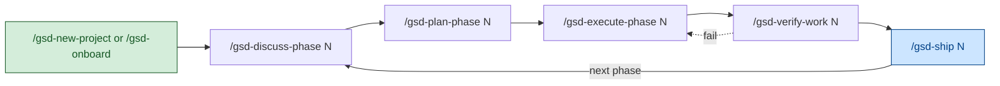
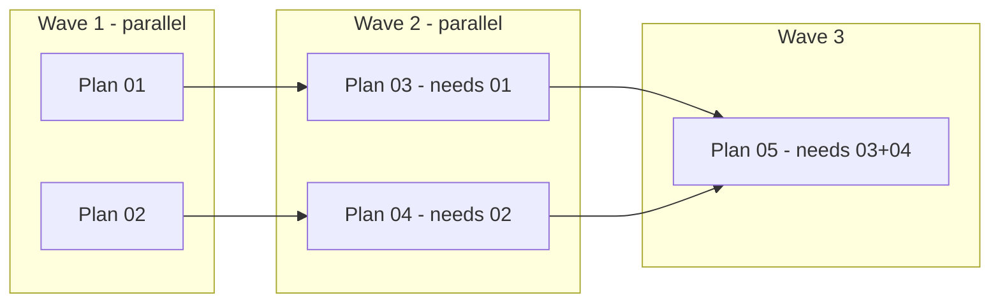

# GSD (Get Shit Done) — Profile

A profile of GSD as it lives in this study (`studies/open-specs-and-standards/gsd-core/`, pinned at `88c50d52d`, 2026-11-23, `@opengsd/gsd-core` v1.23.0). Cites pinned paths so you can jump to source rather than trust paraphrase. Read this alongside [`Profile__OpenSpec.md`](./Profile__OpenSpec.md) and [`Profile__Spec-Kit.md`](./Profile__Spec-Kit.md) — GSD targets the same problem space but takes a third design path: spec-driven *workflow orchestration*, not a spec format.

> [!NOTE]
> **History: gsd-build/get-shit-done → open-gsd/gsd-core.** GSD began as `gsd-build/get-shit-done` (npm `get-shit-done-cc`, first commit 2025-12-15). On 2026-05-22 a maintainer forked it as `get-shit-done-redux`, carrying its code, issues, and PRs; the fork's commit message and README stated the original repo "appears compromised or abandoned" and that its maintainer had been unreachable since 2026-04-01 (`git -C gsd-core show dff176bfd`, `7d2d2ac83`). The fork moved to the `open-gsd` org, was renamed GSD Core on 2026-05-30 (#519), and restarted its version numbers at `1.0.0`; the first stable release under the new name was `1.2.0` on 2026-05-31 (`CHANGELOG.md:2657-2679`). The old line (`get-shit-done-cc` 1.0.0 → 1.42.x) is archived in `docs/RELEASE-NOTES-LEGACY.md`, so a legacy "1.x" number and a current one can collide. The original repo was archived after a final redirect commit (`bdcaab2c752d`, 2026-05-31) that is not in gsd-core's history: gsd-core shares history with it through 2026-05-21 and diverges after.

## TL;DR

GSD is a **context-engineering and multi-agent-orchestration framework** that ships as an installer (`npx @opengsd/gsd-core@latest`) and writes a fleet of slash commands, skills, subagents, hooks, and references into your AI runtime's config directory. The thesis (`docs/explanation/context-engineering.md:7-30`) is that the limiting factor of AI coding is not spec rigor — it's **"context rot," the quality degradation that happens as the model fills its context window**. GSD's answer is to drive every non-trivial task through fresh-context subagents coordinated by thin orchestrators, with state persisted as plain files in `.planning/`.

It is **not** a markdown convention (OpenSpec) and **not** a methodology with phase gates (Spec Kit). It is a *runtime system*. At the pin the filesystem has 72 command files under `commands/gsd/` (each mirrored as a skill under `skills/`), 65 subagents under `agents/`, 29 hook files under `hooks/`, 46 first-party capability manifests under `capabilities/`, and a CLI (`gsd-core/bin/gsd-tools.cjs`) that workflow files query for state. `docs/INVENTORY.md` is the authoritative roster and tells readers to trust the filesystem where docs disagree. The old README's solo-developer, anti-enterprise voice ("no enterprise roleplay") is gone; the current README (`README.md`) is a short, neutral page that points into a Diátaxis-style `docs/` tree. The system is heavy *under the hood* so the user-facing surface can stay at a five-step phase loop.

If OpenSpec's pitch is "tree-of-requirements + deltas," and Spec Kit's pitch is "constitution + gates + executable spec," GSD's pitch is **"a runnable pipeline that keeps the model's context fresh while it does the work."**

## Why this is different from "just write a normal spec"

GSD doesn't replace prose with structured spec primitives — it replaces *driving the model yourself* with a workflow that drives it for you. Four interlocking improvements:

### 1. Conventions: artifacts as a typed file set, plus XML-formatted plans

GSD doesn't introduce a spec grammar. It introduces a **fixed inventory of named markdown files**, each with a fixed role — `docs/ARCHITECTURE.md:784-836`:

| File | Role |
|------|------|
| `PROJECT.md` | Project vision, constraints, decisions, evolution rules |
| `REQUIREMENTS.md` | Scoped requirements (v1/v2/out-of-scope) |
| `ROADMAP.md` | Phase breakdown with status tracking |
| `STATE.md` | Living memory: position, decisions, blockers, metrics |
| `research/` | Domain research (stack, features, architecture, pitfalls) |
| `phases/XX-name/` | Per-phase `CONTEXT`, `RESEARCH`, `PLAN`, `SUMMARY`, `VERIFICATION`, `UAT` files |
| `codebase/`, `onboarding/` | Brownfield mapping from `/gsd-map-codebase` or `/gsd-onboard` |
| `todos/`, `threads/`, `seeds/` | Captured ideas and persistent cross-session context |

Two things worth noting:

- **The convention is the *layout*, not the prose.** Each file has a known location under `.planning/` and a known reader (a specific subagent or workflow). The agent doesn't have to discover where context lives — workflows load it with `gsd-tools.cjs init <workflow>` (`docs/ARCHITECTURE.md:76-83`).
- **Plans use XML, not Markdown.** Each `PLAN.md` task is a typed XML block. The required tags have grown: `type="auto"` and `type="tracer"` tasks must carry `<name>`, `<files>`, `<read_first>`, `<action>`, `<verify>`, `<acceptance_criteria>`, and `<done>`, with optional `<precondition>` and `<reversibility>` elements (`docs/reference/plan-md.md:214-262`):

```xml
<task type="auto">
  <name>Add /reveal endpoint handler</name>
  <precondition>server bootstraps and responds to GET /health (from the tracer slice)</precondition>
  <files>server/reveal.ts</files>
  <action>…</action>
  <verify>curl /reveal?path=… opens the OS file manager</verify>
  <done>Endpoint committed and manually verified</done>
</task>
```

The `<verify>` and `<done>` tags are still the load-bearing parts: the agent has a runnable check and a done-condition baked into the same artifact. `<precondition>` and `<reversibility rating="one-way">` add a design-by-contract front edge and a "pause before a one-way door" signal. Compared to OpenSpec's `Requirement: / Scenario:` headings or Spec Kit's user-story acceptance scenarios, GSD's primitive is **the executable task**, not the behavioral requirement.

### 2. Data compression: fresh context per agent, not deltas

This is GSD's biggest divergence from both alternatives. Where OpenSpec compresses by *delta-spec* and Spec Kit compresses by *artifact split*, GSD compresses by **resetting the context window per unit of work** (`docs/ARCHITECTURE.md:72-74`):

> Every agent spawned by an orchestrator gets a clean context window (up to 200K tokens). This eliminates context rot — the quality degradation that happens as an AI fills its context window with accumulated conversation.

Concretely: a phase is decomposed into plans, each executed in a *fresh* subagent (`docs/explanation/the-phase-loop.md:47-49`). The orchestrator's main session never accumulates the implementation context; it spawns, waits, integrates. On 1M-token models, executor and verifier prompts are enriched with prior-wave summaries and full phase context (`docs/ARCHITECTURE.md:615-622`).

The cost is the eager listing of skills and subagent descriptions in the system prompt every turn. Three mitigations ship:

- **Install profiles** (`docs/FEATURES.md:3445-3462`): `core`, `standard`, `full` (default). `--minimal` and `--core-only` are aliases for `--profile=core`; `/gsd-surface` enables or disables skill clusters without reinstalling.
- **Two-stage hierarchical routing** (`docs/ARCHITECTURE.md:123-127`, issue #2792): six namespace meta-skills (`gsd-workflow`, `gsd-project`, `gsd-quality`, `gsd-context`, `gsd-manage`, `gsd-ideate`) sit above the concrete skills. Only runtimes with non-recursive skill loaders (Cline, Qwen, Hermes, Augment, Trae) get the nested layout; Claude Code, Codex, Cursor and the rest stay flat because their Skill tools cannot route through a router.
- **Compact content** (`workflow.compact_content`): workflows such as `plan-phase` split into a spine plus a detail file read on demand (CHANGELOG 1.14.0).

### 3. Navigation: a phase loop, not a phase pipeline or DAG

GSD's organizing structure is a **linear loop of orchestrator commands**, each of which spawns specialized subagents and writes a known artifact — `README.md` ("How it works"), `docs/explanation/the-phase-loop.md`, `docs/COMMANDS.md`:



| Command | Spawns | Artifact |
|---------|--------|----------|
| `/gsd-new-project` | project researchers (parallel) → research-synthesizer → roadmapper | `PROJECT.md`, `REQUIREMENTS.md`, `ROADMAP.md`, `STATE.md`, `research/` |
| `/gsd-discuss-phase N` | advisor-researcher / assumptions-analyzer | `{N}-CONTEXT.md` |
| `/gsd-plan-phase N` | phase-researcher → planner → plan-checker (loop until pass) | `{N}-RESEARCH.md`, `{N}-{M}-PLAN.md` |
| `/gsd-execute-phase N` | wave-grouped executors (parallel within wave) → verifier | `{N}-{M}-SUMMARY.md`, `{N}-VERIFICATION.md` |
| `/gsd-verify-work N` | UAT walkthrough; optional behavior verifier first (`deep-verify`); debugger on failure | `{N}-UAT.md`, fix plans if issues |
| `/gsd-ship N` | PR creation; refuses a phase ROADMAP.md does not record as complete | GitHub PR |

The roster of who spawns whom is in `docs/INVENTORY.md` (Agents table). The wave-execution model is the key parallelism primitive (`docs/ARCHITECTURE.md:595-613`):



Plans with no shared dependencies run in parallel; later waves wait for earlier ones. Version 1.3.0 added a Vertical MVP Slice mode and `/gsd-mvp-phase`, which make the vertical-slice preference explicit.

Compared to OpenSpec's "dependencies are enablers, not gates" and Spec Kit's "gates are gates," GSD's stance is **"the orchestrator decides what runs in parallel, you don't think about it."** The agent model is a thin-orchestrator pattern (`docs/ARCHITECTURE.md:76-83`) that *never does heavy lifting* — it loads context, spawns agents, collects results, updates state.

### 4. Distinctive: multi-runtime, hooks, and atomic commits as an integration layer

GSD has three structural moves that neither OpenSpec nor Spec Kit ship, and since the move a fourth:

**(a) 18-runtime installer** (`bin/install.js`; runtime ids in `src/runtime-name-policy.cts:492-520` and `:599-602`; contract matrix at `docs/ARCHITECTURE.md:1048-1070`). The same core artifacts and workflows install into Claude Code, OpenCode (1.x and 2.x), Kilo, Codex, GitHub Copilot, Antigravity, Cursor, Windsurf, Augment, Trae, Qwen Code, Hermes Agent, Kimi CLI, Kimi Code, CodeBuddy, Cline, ZCode, and pi. Claude Code can also install it as a native plugin (`.claude-plugin/`). Gemini CLI was removed after Google discontinued it on 2026-06-18; Antigravity is the named successor (`src/runtime-name-policy.cts:38-40`). Since 1.7.0 most runtimes are driven through a versioned Host-Integration Interface with per-runtime adapters (`docs/whats-new-1.7.0.md`). Spec Kit covers 43 integrations; OpenSpec ~25. GSD's bet is on portability of the workflow, not the spec format.

**(b) Hook system as runtime guardrails** (`docs/ARCHITECTURE.md:283-316`; full roster `docs/INVENTORY.md:810-845`). 29 hook files fire on `PreToolUse` / `PostToolUse` / `SessionStart` / `statusLine` and runtime-native events (Cursor, Windsurf). A selection:

| Hook | Event | Purpose |
|------|-------|---------|
| `gsd-statusline.js` | `statusLine` | Model + task + directory + context-usage bar |
| `gsd-context-monitor.js` | `PostToolUse` | Injects context warnings at 35%/25% remaining (configurable) |
| `gsd-prompt-guard.js` | `PreToolUse` | Scans `.planning/` writes for prompt injection (advisory) |
| `gsd-read-injection-scanner.js` | `PostToolUse` | Scans `Read`/`WebFetch`/`WebSearch` output for injected instructions |
| `gsd-secret-read-guard.js` | `PreToolUse` | Hard-blocks reads of `.env*` and `.secrets` |
| `gsd-write-guard.js` | `PreToolUse` | Hard-blocks a whole-file `Write` that drastically shrinks a curated `.planning/` artifact |
| `gsd-worktree-path-guard.js` | `PreToolUse` | Hard-blocks edits with absolute paths outside the worktree |
| `gsd-workflow-guard.js` | `PreToolUse` | Detects edits outside GSD workflow context (advisory, opt-in) |
| `gsd-read-guard.js` | `PreToolUse` | Advisory guard against Edit/Write on files not yet read |
| `gsd-validate-commit.sh` | `PreToolUse` | Conventional-commit enforcement |
| `gsd-phase-boundary.sh` | `PostToolUse` | Phase boundary detection |
| `gsd-check-update.js` | `SessionStart` | Trigger for the background update check |

The point: the workflow doesn't just instruct the model, it *constrains* the model's tool calls in flight. Several hooks now block rather than advise, and each enforcement hook must declare its crash policy (`ALLOW` or `DENY`) explicitly (`docs/ARCHITECTURE.md:306-316`). Injection patterns are centralized in `src/security.cts` and shared with the hooks through `hooks/lib/injection-patterns.js` (`docs/ARCHITECTURE.md:1012-1042`), because GSD's planning artifacts are themselves LLM system prompts — user-controlled text flowing into them is an indirect-prompt-injection vector by construction. A package-legitimacy gate also checks researcher-named packages against registry signals before an executor may install them (`docs/ARCHITECTURE.md:990-1010`).

**(c) Atomic commits per task** (`docs/explanation/the-phase-loop.md:47`). Each executor commits immediately after its task finishes:

```text
abc123f docs(08-02): complete user registration plan
def456g feat(08-02): add email confirmation flow
hij789k feat(08-02): implement password hashing
lmn012o feat(08-02): create registration endpoint
```

Plus a "parallel commit safety" layer (`docs/ARCHITECTURE.md:624-629`): parallel executors skip pre-commit hooks via `--no-verify` (the orchestrator runs them once after the wave), and `STATE.md` writes go through atomic file-locking (`STATE.md.lock` with `O_EXCL`, 10s stale-lock detection). Since the move, the write path also has a declared per-field preservation contract (`docs/ARCHITECTURE.md:631-655`, ADR-3408): STATE.md's body is authoritative, and a write cannot proceed without the pre-write snapshot it compares against. This is the kind of detail you only build if you've watched two parallel agents stomp on each other's STATE.md edits.

**(d) Capabilities: a plugin system** (`capabilities/*/capability.json`, `docs/explanation/capability-overlay-model.md`). Optional features — TDD, live-DOM UAT, deep verification, drift checks, reviewer lanes, per-runtime integrations — are packaged as capabilities that hook into named loop points (`plan:pre`, `verify:pre`, `review:pre`, `execute:wave:post`). Third parties install their own with `gsd capability install`, and a non-endorsing Community Capability Registry lists them. This replaces the old answer to extensibility, which was "fork or PR upstream."

## What's actually inside this submodule

Mapping the upstream layout you'll be reading:

| Path | What's there |
|------|--------------|
| `gsd-core/README.md` | Short pitch, five-step loop, quickstart, links into `docs/` |
| `gsd-core/README.{zh-CN,ja-JP,ko-KR,pt-BR}.md` | Translated READMEs; `docs/` has matching locale trees |
| `gsd-core/CONTEXT.md` | Internal domain glossary and rulesets (~600 KB) |
| `gsd-core/CHANGELOG.md` | Release notes from `1.2.0` on; legacy line in `docs/RELEASE-NOTES-LEGACY.md` |
| `gsd-core/VERSIONING.md` | Semver tiers, `latest`/`next` dist-tags, hotfix and RC flow |
| `gsd-core/docs/README.md` | Docs index (tutorials, how-to, reference, explanation) |
| `gsd-core/docs/ARCHITECTURE.md` | System architecture for contributors (read this if you want the *why*) |
| `gsd-core/docs/explanation/` | Context engineering, the phase loop, multi-agent orchestration, security model, capability models |
| `gsd-core/docs/reference/` | `agents.md` role cards, `plan-md.md`, `state-md.md`, capability manifest, host-integration interface |
| `gsd-core/docs/COMMANDS.md` | Per-command reference |
| `gsd-core/docs/CONFIGURATION.md` | Full `.planning/config.json` schema |
| `gsd-core/docs/CLI-TOOLS.md` | `gsd-tools` CLI reference |
| `gsd-core/docs/INVENTORY.md` | **Authoritative roster** of every shipped surface — agents, commands, workflows, references, CLI modules, hooks |
| `gsd-core/docs/FEATURES.md` | Feature reference with numbered requirements (~5000 lines) |
| `gsd-core/docs/USER-GUIDE.md` | End-to-end walkthrough + usage examples |
| `gsd-core/docs/adr/` | Architecture decision records |
| `gsd-core/docs/issue-driven-orchestration.md` | Mapping `tasks.md` → GitHub issues |
| `gsd-core/agents/` | 65 subagent definitions (`gsd-planner.md`, `gsd-executor.md`, `gsd-verifier.md`, …) |
| `gsd-core/commands/gsd/` | 72 slash-command prompt files, including six `ns-*.md` namespace routers |
| `gsd-core/skills/` | 72 skill directories, one per command |
| `gsd-core/capabilities/` | 46 first-party capability manifests |
| `gsd-core/gsd-core/workflows/` | Per-workflow orchestration logic (formerly `get-shit-done/workflows/`) |
| `gsd-core/gsd-core/references/` | Shared knowledge documents (`gates.md`, `model-profiles.md`, `tdd.md`, `questioning.md`, …) |
| `gsd-core/gsd-core/templates/` | Markdown templates for all planning artifacts |
| `gsd-core/gsd-core/bin/gsd-tools.cjs` | The CLI workflows query for state (replaced the retired `gsd-sdk`) |
| `gsd-core/hooks/` | 29 runtime hooks plus `hooks/lib/` shared helpers |
| `gsd-core/src/` | TypeScript (`.cts`) sources for the CLI modules, gates, state, runtimes |
| `gsd-core/bin/install.js` | The 18-runtime installer |
| `gsd-core/bin/gsd-mcp-server.js` | Companion MCP server (stdio JSON-RPC) |

If you only have time for two files: read `docs/ARCHITECTURE.md` end-to-end (it's the system architecture document) and skim `docs/INVENTORY.md` (it's the authoritative roster of every shipped surface).

## How to get started (if you actually wanted to use it)

### Install once

```bash
# Interactive — prompts for runtime + location
npx @opengsd/gsd-core@latest

# Non-interactive
npx @opengsd/gsd-core@latest --claude --global              # Install to ~/.claude/
npx @opengsd/gsd-core@latest --claude --local --profile=core # Minimal surface (alias: --minimal)
```

The installer prompts for **runtime** and **location** (global / local) — `README.md` (Quickstart), `docs/how-to/install-on-your-runtime.md:17-27`. Do not copy files from `agents/` or `commands/` by hand: the installer converts them per runtime. Pre-releases ship on the `next` dist-tag (`VERSIONING.md`). Leftovers from the old `get-shit-done-cc` package can show a false update badge; `docs/cleanup-get-shit-done-cc.md` explains the cleanup the installer now performs.

The docs still show `claude --dangerously-skip-permissions` in the walkthrough (`docs/USER-GUIDE.md:616`), but now add a caution: the flag is optional, for low-stakes or throwaway contexts, and real work should start from `claude` after reading the security model (`docs/USER-GUIDE.md:636-640`). The installer pre-populates Claude Code `permissions.allow`/`deny` entries (CHANGELOG 1.4.0).

### The everyday loop

```text
/gsd-new-project                          # questions → research → REQUIREMENTS.md + ROADMAP.md
/gsd-discuss-phase 1                      # capture intent → 1-CONTEXT.md
/gsd-plan-phase 1                         # research + plan + verify → 1-{N}-PLAN.md
/gsd-execute-phase 1                      # wave-parallel execution → 1-{N}-SUMMARY.md, 1-VERIFICATION.md
/gsd-verify-work 1                        # human UAT → 1-UAT.md
/gsd-ship 1                               # PR with auto-generated body
... repeat for phase 2, 3, ...  (or /gsd-progress --next to pick the next step)
/gsd-complete-milestone                   # archive + tag release
/gsd-new-milestone                        # next version
```

Two shortcuts when full ceremony is overkill (`docs/COMMANDS.md`, `/gsd-quick` and `/gsd-fast`):

- `/gsd-quick "<task>"` — same agents, skips research/plan-check/verify by default; flags `--discuss --research --validate --full` add them back. Lives in `.planning/quick/`.
- `/gsd-fast "<text>"` — inline trivial task, no subagents at all. For one-liner edits.

For brownfield work, `/gsd-onboard` now wraps `/gsd-map-codebase`, `/gsd-ingest-docs`, and `/gsd-new-project` so the planner has codebase awareness from turn one without overwriting existing planning files (`docs/USER-GUIDE.md:651-659`).

### When something breaks mid-phase

GSD's recovery surface is heavier than either competitor's (`docs/how-to/recover-and-troubleshoot.md`):

- `/gsd-pause-work` writes a handoff (`HANDOFF.json`, `continue-here.md`) so a later session can resume cleanly; `--report` adds a session summary.
- `/gsd-resume-work` restores from the last session.
- `/gsd-forensics` runs a post-mortem on a failed workflow run.
- `/gsd-debug` opens a persistent-state debugging session with `gsd-debugger`.
- `/gsd-health [--repair]` validates `.planning/` integrity and auto-repairs.
- `/gsd-undo` and `gsd-tools state rebuild` (1.7.0) cover the cases where state and code have drifted.

This is downstream of the design choice: because GSD ships a runtime, things can go wrong at runtime in ways an OpenSpec markdown convention can't.

## Mental model for using it well

- **The orchestrator is the product, not the spec.** Treat slash commands as the primary interface; the markdown files in `.planning/` are byproducts the agents read, not documents you author. If you're hand-editing PLAN.md mid-execution, you're fighting the system.
- **Respect the size budgets.** Workflow files are held to per-file byte budgets by tier — XL 90,000, LARGE 54,000, DEFAULT 38,000 — enforced by a test, and the ceilings may only go down (`docs/ARCHITECTURE.md:145-170`). The stated reason is quality, not cost: leaner instructions produce better plans. When something crosses, the pattern is *extract into sub-files and references/*, not split arbitrarily.
- **`STATE.md` is the across-session brain, not a status report.** It tracks decisions, blockers, position. Treat it as the place a fresh subagent reads to pick up where you left off. (`docs/reference/state-md.md` is the canonical reference.)
- **Pick an install profile if you're token-conscious.** `--profile=core` (or `--minimal`) shrinks the eager skill listing; `/gsd-surface` adjusts it later without a reinstall (`docs/FEATURES.md:3445-3462`).
- **Disable MCP servers you don't use.** GSD's docs explicitly call out that MCP tool schemas can cost 20k+ tokens per turn — often dwarfing what model-profile tuning saves (`docs/ARCHITECTURE.md:129-131`). The toggle is in Claude Code's `enabledMcpjsonServers` / `disabledMcpjsonServers`, *not* a GSD setting.
- **Trust the wave model.** Don't try to manually serialize plans the system has marked as parallel. The dependency analysis is in the planner's output; if it's wrong, fix the plan, don't fight execute-phase.
- **Atomic commits are non-negotiable.** Don't squash mid-phase. Git bisect over per-task commits is the debugging mechanism the whole system assumes.
- **Add capabilities deliberately.** Third-party capabilities compose into the same registry as first-party ones and can inject guidance into planning and review; read `docs/explanation/capability-trust-model.md` before installing one.

## When NOT to reach for this

- **You want a spec format, not a workflow.** GSD doesn't *give* you a typed behavioral-spec primitive (no `Requirement:` heading, no `[NEEDS CLARIFICATION]` marker, no `ADDED/MODIFIED/REMOVED` deltas). If your value is in the spec artifact itself — for review, for compliance, for handoff — OpenSpec or Spec Kit are better fits.
- **Heavy brownfield surgical edits.** GSD's "phase" unit assumes you can decompose the work into plans with verifiable goals. A one-line bug fix doesn't fit that shape — use `/gsd-fast` and accept that you're bypassing the system.
- **Single-runtime, hand-tuned setups.** If you've already invested in custom Claude Code skills/hooks, GSD's installer will write into the same directory and you'll need to manage overlap. Install profiles help, but a heavily customized `.claude/` is friction.
- **You don't want a project-level token floor.** Even the `core` profile adds fixed system-prompt overhead on every turn. For ad-hoc one-shot work, plain Claude Code is lighter.
- **Compliance-heavy environments.** GSD has security hardening (`src/security.cts`, blocking guards, a package-legitimacy gate, `/gsd-secure-phase`) but it's not built around an immutable architectural constitution the way Spec Kit is. If you need an auditable paper trail of "we considered this and rejected it," Spec Kit's gates are designed for that and GSD's atomic-commit history is not the same artifact.
- **You don't trust unattended execution.** The loop is designed to run waves of executors without per-step approval. The docs now say to keep confirmations on for real work, but if you want to review every step before it runs you'll spend more time approving than building.

## GSD vs. Spec Kit vs. OpenSpec — the honest comparison

The three tools share a problem space (human + AI alignment) but make almost orthogonal bets.

| Axis | GSD | Spec Kit | OpenSpec |
|------|-----|----------|----------|
| **Primary artifact** | `.planning/` directory of typed files (PROJECT, REQUIREMENTS, ROADMAP, STATE, PLAN, SUMMARY) | `.specify/` + `specs/NNN-feature/` (spec.md, plan.md, tasks.md, contracts/, quickstart.md) | `openspec/specs/` + `openspec/changes/<name>/` (proposal, design, tasks, delta specs) |
| **Spec primitive** | XML `<task>` block with `<verify>`, `<acceptance_criteria>`, `<done>` (optional `<precondition>`, `<reversibility>`) | User Story (priority) + Acceptance Scenario + `[NEEDS CLARIFICATION]` | `Requirement:` (RFC 2119) + `Scenario:` (Given/When/Then) |
| **Workflow** | Five-step phase loop driven by orchestrators that spawn fresh subagents | Linear phases gated by Constitution (`/speckit.constitution → specify → clarify → plan → tasks → implement → converge`) | Fluid actions; dependency DAG enables but doesn't gate (`/openspec-propose → apply → archive`) |
| **Change model** | Phase = unit of work; plans within phase; atomic git commits per task | Full spec per feature in `specs/NNN-name/`; new feature = new branch + folder | Delta specs (`ADDED/MODIFIED/REMOVED`) merged into source-of-truth on archive |
| **Architectural discipline** | None encoded in the user's project; plan-vs-codebase drift guard; byte budgets on GSD's own workflow files | Constitution with 9 articles + phase gates (Simplicity, Anti-Abstraction, Integration-First) | Convention-light; trust the human + agent loop |
| **Parallelism** | Wave-based: planner emits dependency graph, executor runs independent plans concurrently; plans can name another runtime as executor (1.22–1.23) | None encoded; `[P]` markers in `tasks.md` flag parallelizability for the implementer | Schema DAG can be walked in parallel where artifacts are independent |
| **Token-cost awareness** | First-class: install profiles (`core`/`standard`/`full`), namespace meta-skills (#2792), compact content, MCP-budget docs | Implicit: extension/preset system can trim what loads, but no explicit token budget | Implicit: lightweight by default |
| **Toolchain** | Node/npm (`@opengsd/gsd-core`), `gsd-tools` CLI (TypeScript sources), shell hooks | Python (`uv` / `pipx`), shell scripts, DocFX site | Node/npm (`@fission-ai/openspec`) |
| **Runtime reach** | 18 installable runtimes (Claude Code, OpenCode, Kilo, Codex, Copilot, Antigravity, Cursor, Windsurf, Augment, Trae, Qwen, Hermes, Kimi CLI, Kimi Code, CodeBuddy, Cline, ZCode, pi) | 43 integrations (Nov 2026) | 25+ integrations |
| **Extensibility** | Capabilities: first-party manifests plus third-party installs (`gsd capability install`) and a Community Capability Registry | Formal: 4-level priority stack (overrides → presets → extensions → core) plus workflows and bundles, 200+ community extensions | Schema-driven: define your own artifact DAG in `schema.yaml` |
| **Status (Nov 2026)** | Active as GSD Core, v1.23.0; continuation of the archived `gsd-build/get-shit-done` | Active, v1.4.x | Active, v2.1.x |
| **Recovery / state** | `/gsd-pause-work` + `HANDOFF.json` + `STATE.md` + `/gsd-resume-work` + `/gsd-forensics` + `/gsd-health --repair` + `/gsd-undo` | Manual — re-run the affected phase command | Manual — change folders are inherently resumable |
| **Best fit** | Solo or small-team delivery on greenfield + light brownfield, where unattended multi-hour runs are the goal | Greenfield enterprise work where alignment, compliance, and traceability matter | Brownfield iteration where you want spec discipline without ceremony |

The original README positioned GSD against BMAD and Spec Kit as tools that "make things way more complicated than they need to be," with "the complexity … in the system, not in your workflow" (the legacy README, last seen at the 2026-05-04 pin `61773332d61a`, `README.md:67-68`). GSD Core dropped that framing from its README, but the trade is unchanged: GSD pushes the complexity into the runtime so the user-facing surface stays small, where Spec Kit pushes it into the spec artifacts and OpenSpec keeps it minimal everywhere by sacrificing orchestration. The capability system narrows one gap with Spec Kit: GSD now has a formal extension surface.

## Changes since the previous pin (2026-05-31 → 2026-11-23)

The study now pins `open-gsd/gsd-core` at `88c50d52d` instead of `gsd-build/get-shit-done` at `bdcaab2c752d`. The old pin is not an ancestor of the new one; the 2026-05-04 pin (`61773332d61a`) is. gsd-core has 4,414 commits after `61773332d61a`, about 3,840 of them since the fork on 2026-05-22. License unchanged (MIT).

- **Repository, package, and directory renames.** `gsd-build/get-shit-done` → `get-shit-done-redux` fork (2026-05-22) → `open-gsd/gsd-core` (2026-05-30). npm `get-shit-done-cc` → `@opengsd/get-shit-done-redux` → `@opengsd/gsd-core`, binary `gsd-core`. The runtime directory `get-shit-done/` became `gsd-core/` (2026-06-02, #615).
- **Version line restarted.** The old line ended at 1.42.3 stable. GSD Core restarted at 1.0.0; 1.2.0 (2026-05-31) is its first stable public release, and v1.23.0 (2026-11-23) is current. Legacy notes moved to `docs/RELEASE-NOTES-LEGACY.md`.
- **`gsd-sdk` retired.** The separate SDK package and its shim were removed (2026-05-25 to 2026-05-30); workflows call `gsd-tools.cjs` / `gsd_run`, built from TypeScript sources in `src/`.
- **Capability system** (1.5.0 on, ADR-1244): first-party features ship as capability manifests; `gsd capability` installs, lists, and updates third-party ones (1.6.0); Community Capability and EoS registries list them (1.7.0 on).
- **Runtimes.** Added Kimi CLI, Kimi Code (1.9.0), ZCode, pi, OpenCode 2.x (1.17.0), a native Claude Code plugin install (1.4.0), and a companion MCP server. Gemini CLI removed. Most runtimes moved onto a versioned Host-Integration Interface (1.7.0).
- **Planning and verification.** Plan-vs-codebase drift guard (1.2.0), Vertical MVP Slice mode and `/gsd-mvp-phase` (1.3.0), cached research with a package-legitimacy gate (1.4.0), plan-review convergence, live-DOM UAT (1.12.0), deep verification before UAT and cross-runtime plan execution (1.22.0–1.23.0). The `<task>` schema gained required `<read_first>` and `<acceptance_criteria>` and optional `<precondition>` and `<reversibility>`.
- **Safety and state.** New blocking hooks (secret-read, write-shrink, worktree-path, agent-isolation guards); declared crash policy per hook; STATE.md writes governed by a per-field preservation contract (ADR-3408, ADR-3473).
- **Docs and tone.** The 1,000-line README was replaced by a short one plus a tutorials / how-to / reference / explanation tree. The anti-enterprise voice is gone, and the docs now caution against `--dangerously-skip-permissions` for real work.
- **Counts.** 33 → 65 agents, 67 → 72 command files, 14 → 29 hook files, 16 → 18 runtimes.
- The lede still holds: GSD ships no behavioral-spec grammar and resets the window per task.

## One-line summary

> GSD wins by treating context-rot — not spec rigor — as the limiting factor of AI coding: GSD Core ships a 72-command, 65-subagent, 29-hook runtime with a capability plugin system that decomposes work into fresh-context wave-parallel executors, persists state in `.planning/`, and installs into 18 AI runtimes — and it pays for that with a token floor and a heavy-under-the-hood surface that you mostly don't see until something breaks.
